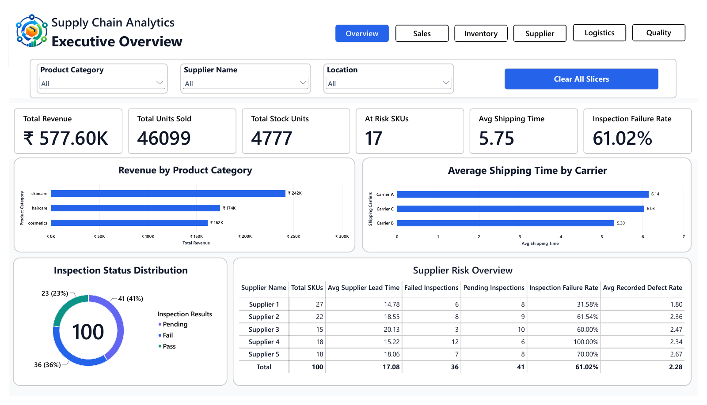

# Supply Chain Analytics

A six-page Power BI report covering sales, inventory, suppliers, logistics and inspection outcomes across a sample supply-chain dataset.

**[View the complete PDF report](report.pdf)** · **[Download the Power BI file](Supply-Chain.pbix)** · **[Dataset](supply_chain_data.csv)**

## Business questions

Which product categories contribute revenue? Which SKUs have low or zero stock? Where do suppliers, shipping routes and inspection outcomes suggest areas for investigation?

## Report pages

1. Executive Overview
2. Sales
3. Inventory
4. Supplier
5. Logistics
6. Quality

Product category, supplier and location slicers support exploration across the report.

## Findings shown in the report

- **100 SKUs**, **46,099 units sold** and approximately **577.60K revenue**, displayed with the rupee symbol in the report.
- **17 at-risk SKUs** under the report's stock rules: 16 low-stock and one out-of-stock SKU.
- Average recorded shipping time of **5.75**; Carrier B has the lowest carrier average shown, **5.30**.
- **36 failed**, **23 passed** and **41 pending** inspections. The **61.02% failure rate** is 36 / (36 + 23), excluding pending inspections; it is not 61.02% of all 100 SKUs.

The dataset is a sample for analytical practice. The figures identify records for investigation and do not demonstrate operational savings, causal supplier performance or future demand.

## View without a Power BI account

Open the [PDF](report.pdf) or the screenshots on GitHub. For interactive exploration, download the repository and open `Supply-Chain.pbix` in Power BI Desktop on Windows. This repository does not require a Power BI service workspace to view the static report.

If refreshing prompts for the original local file, use **Transform data > Data source settings > Change Source** to choose the included `supply_chain_data.csv`. Inspect the existing query in Power Query if necessary, then refresh. A clean-machine refresh has not been verified.

## Files and context

- [Power BI report](Supply-Chain.pbix)
- [Full PDF export](report.pdf)
- [Source CSV](supply_chain_data.csv)
- [Inventory screenshot](inventory.png)
- [Quality screenshot](quality.png)

Training portfolio project by Tejesh Ramesh Bawa. The report and supplied CSV are preserved; currency formatting and measure definitions describe the existing report. No source dataset licence is asserted.
